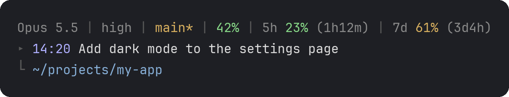

# claude-statusline

**English** | [한국어](README_한국어.md)

A fast, minimal status line for [Claude Code](https://code.claude.com), written in plain C: usage, git branch, your last prompt, and the working directory in three quiet lines.



> **Updating from the gauge version?** The layout is new, and line 2 now shows **the last prompt you typed** on screen, including anything secret you pasted into it.

## Install

Tested on macOS (Apple silicon); Linux is untested. Requires git 2.17 or later for the branch (2.38 or later recommended for security), a C compiler, and `make` (on macOS: `xcode-select --install`). `python3` is used only to edit `settings.json`; without it, the installer prints the lines to add yourself.

```sh
git clone https://github.com/sjlee42/claude-statusline.git
cd claude-statusline
make install
```

| Command | What it does |
|---|---|
| `make install` | Builds to `~/.claude/statusline` and sets `statusLine` in `settings.json` (keeps a `.bak`). Asks before replacing another status line. |
| `git pull && make install` | Updates the binary. An existing `statusLine` entry is left as it is, so add `refreshInterval` yourself if it has none. |
| `make uninstall` | Removes the binary, and the `statusLine` entry if it runs this binary. |

Run these without `sudo`. `settings.json.bak` can contain API keys; keep it out of dotfile repositories.

`CLAUDE_CONFIG_DIR` is honored and must be an absolute path. To set it up by hand, add this to `~/.claude/settings.json` (with `CLAUDE_CONFIG_DIR`, use that directory in both paths):

```json
{
  "statusLine": {
    "type": "command",
    "command": "~/.claude/statusline",
    "refreshInterval": 60
  }
}
```

`refreshInterval` keeps the time left until each reset current while the session is idle.

## What it shows

| Line | Content |
|---|---|
| 1 | Model, effort, git branch (`*` when there are changes), context used, 5-hour and 7-day limits with the time left until reset |
| 2 | Time and first 60 characters of the last prompt you typed |
| 3 | Working directory |

Line 2 skips messages that start with `<` (Claude Code marks command output that way) and records over 8 MB, such as very large pasted images, and shows the prompt before them.

Percentages are green below 50%, amber from 50%, and red from 80%. Context shows 0% until Claude Code reports it. Other parts without data are left out: the branch outside git, the limits without a Pro/Max plan, line 2 before the first prompt (or when it is more than 64 MB back).

## Speed

Median of repeated runs on an Apple M2 with synthetic transcripts, including process start-up.

| Case | bash + `jq` original | This (C) |
|---|---|---|
| Short session | 31.4 ms | **2.6 ms** |
| 32 MB session | 459.3 ms | **2.5 ms** |
| Last prompt 17 MB back (the original missed it) | 455.3 ms | **4.5 ms** |
| Inside a git repository | 32.6 ms | **6.7 ms** |

Peak memory outside git is 1.6 MB, against 7.0 MB for the original.

The transcript is read backward from its end until the last prompt is found, so the cost depends on how far back that prompt is, not on how long the session is.

## FAQ

**Does it use tokens or context?** No. It runs locally and its output is only drawn on screen. See the [official docs](https://code.claude.com/docs/en/statusline).

**What does it read?** The status line payload from Claude Code, the end of the current session's transcript, and `git status`. The program itself has no network code and writes no files. `git status` follows that repository's git config, which can name programs to run (clean filters, for example), so open only repositories you trust, as you would before running `git status` yourself.

**My last prompt shows in screenshots. Is that a problem?** It can be. Line 2 shows what you typed, pasted keys included, and line 3 shows your folder, so check both before you share your screen.

**Where did the palettes and bars go?** This version has a single style. The earlier one is at [`96bad0c`](https://github.com/sjlee42/claude-statusline/tree/96bad0c). Old flags in your `settings.json` are ignored.

## Other Claude Code status lines

If you want more features, themes, or a visual editor, these are great choices. Star counts were checked on 2026-11-09.

| Project | ★ | Language | Highlights |
|---|---|---|---|
| [jarrodwatts/claude-hud](https://github.com/jarrodwatts/claude-hud) | 29.1k | JavaScript (plugin) | Multi-line HUD: context, active tools, running agents, todo progress |
| [sirmalloc/ccstatusline](https://github.com/sirmalloc/ccstatusline) | 13.6k | TypeScript | Most customizable; powerline style, themes, interactive TUI editor |
| [Haleclipse/CCometixLine](https://github.com/Haleclipse/CCometixLine) | 3.5k | Rust | Fast native binary, two-line layout with usage bars and themes |
| [kamranahmedse/claude-statusline](https://github.com/kamranahmedse/claude-statusline) | 1.4k | Shell | Big, readable dot gauges for current and weekly usage (inspired this project) |
| [Owloops/claude-powerline](https://github.com/Owloops/claude-powerline) | 1.2k | TypeScript | vim-style powerline with minimal, powerline, capsule and TUI styles |
| [leeguooooo/claude-code-usage-bar](https://github.com/leeguooooo/claude-code-usage-bar) | 389 | Python | 5h/7d usage bars, reset countdowns, 3 styles × 9 themes |
| [Astro-Han/claude-pace](https://github.com/Astro-Han/claude-pace) | 245 | Bash + jq | Pace-aware quota tracking in a single file |
| [Wangnov/claude-code-statusline-pro](https://github.com/Wangnov/claude-code-statusline-pro) | 239 | Rust | Gradient context bar, Nerd Font, emoji or text modes |
| [alp82/claude-statusline](https://github.com/alp82/claude-statusline) | 26 | Bash | Context, 5h and 7d bars with per-agent rows |
| [Dworf/statusline-bar](https://github.com/Dworf/statusline-bar) | 24 | Bash + jq | Presets and themes with 49 selectable data tokens |

Also see [ccusage](https://github.com/ccusage/ccusage) (★19.4k), a usage and cost analysis tool that also offers a status line mode.

**Why another one?** To see the limits, the branch and the question you last asked at a glance, at native speed, from one file small enough to read in one sitting.

## License

[MIT](LICENSE)
