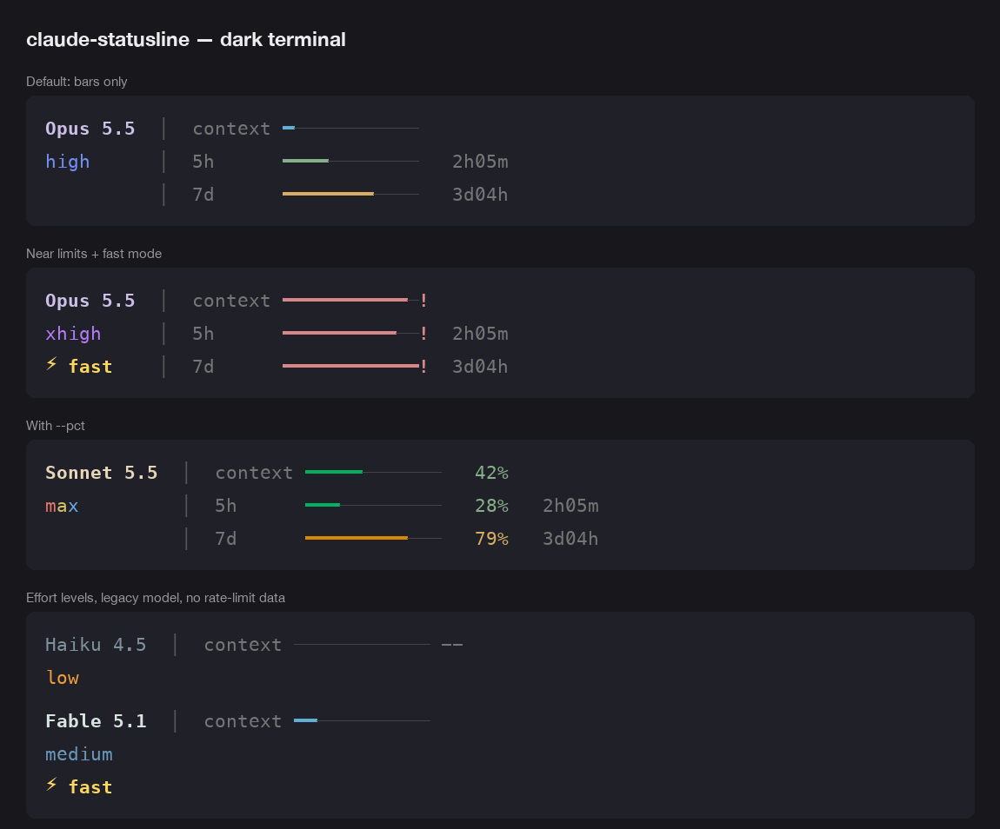
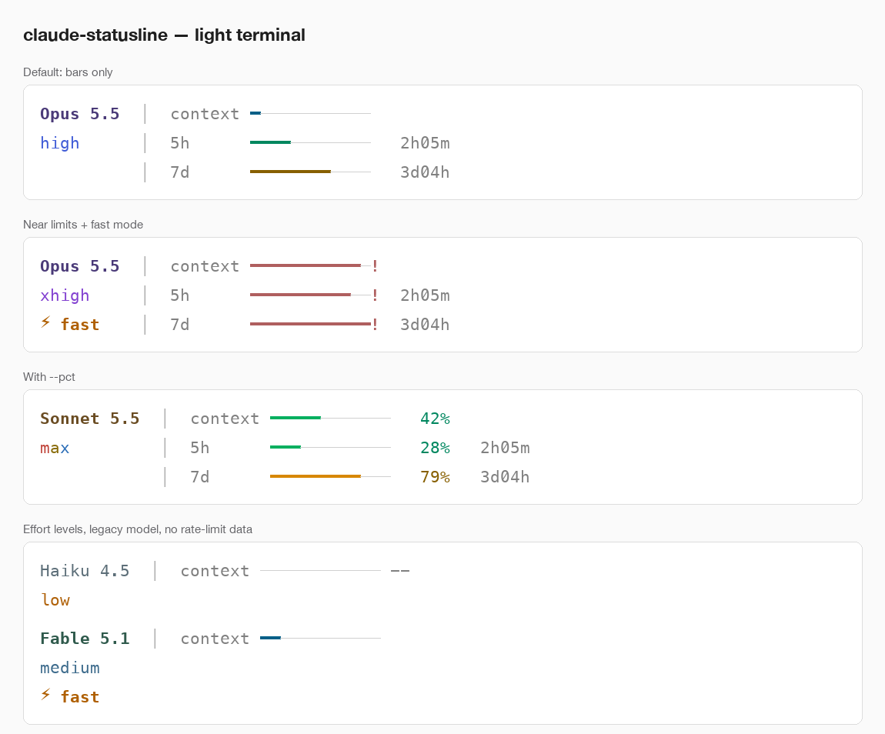
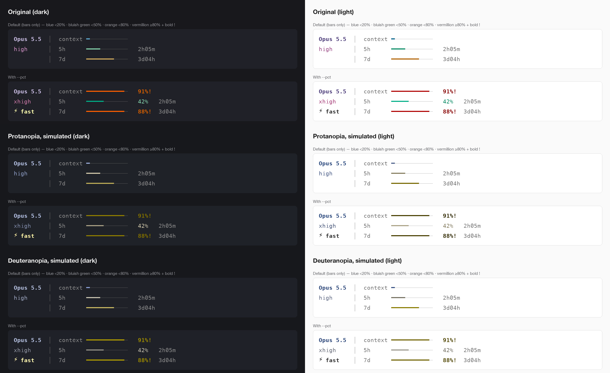

# claude-statusline

**English** | [한국어](README_한국어.md)

A fast, minimal status line theme for [Claude Code](https://code.claude.com), written in plain C: context window and 5-hour/weekly usage bars, with dark, light, and color-blind palettes.
One ~50 KB binary with no dependencies (no `jq`, Node, or Python at run time). Each run takes about 3 ms, most of it process start-up.
You pick the palette once at install time, and severity is never shown by color alone.

```
Opus 5.5  │  context ━━━━━───────
high      │  5h      ━━━━━━━━────   2h05m
⚡fast    │  7d      ━━━━━━━━━━━─!  3d04h
```

With `--pct`, the percentages are printed too:

```
Opus 5.5  │  context ━━━━━───────   42%
high      │  5h      ━━━━━━━━────   65%   2h05m
⚡fast    │  7d      ━━━━━━━━━━━─   88%!  3d04h
```

| Dark terminal | Light terminal (`--light`) |
|---|---|
|  |  |

## Install

Requires a C compiler and `make` (on macOS: `xcode-select --install`). `python3` is used only to edit `settings.json`; without it, setup prints the line to add yourself.

```sh
git clone https://github.com/sjlee42/claude-statusline.git
cd claude-statusline
make install
```

`make install` builds the binary and copies it to `~/.claude/statusline`. On first install it asks three questions, shows a preview, and writes the `statusLine` entry to `~/.claude/settings.json` (keeping a `.bak` copy):

1. Terminal background: dark or light
2. Color-blind friendly palette: yes or no
3. Percentage numbers next to the bars: yes or no

| Command | What it does |
|---|---|
| `git pull && make install` | Update. Only the binary is replaced; your palette is kept. |
| `make setup` | Choose the palette again. |
| `make uninstall` | Remove the binary, and the `statusLine` entry if it runs this binary. |

If `CLAUDE_CONFIG_DIR` is set, these use that directory instead of `~/.claude`.

### Manual setup

Add this to `~/.claude/settings.json` with the flags you want:

```json
{
  "statusLine": {
    "type": "command",
    "command": "~/.claude/statusline --dark"
  }
}
```

| Flag | Effect |
|---|---|
| `--dark` (default) / `--light` | palette for a dark or light terminal background |
| `--cb` | color-blind friendly palette (red-green safe) |
| `--pct` | also print the percentage next to each bar |

## What it shows

| Column | Content |
|---|---|
| Left | Model name, then the reasoning effort (`low` … `max`), then `⚡fast` when fast mode is on |
| Right | Three aligned bars: **context** (context window), **5h** (5-hour rate limit), **7d** (7-day rate limit), each limit with the time left until it resets, in gray |

- The 5h and 7d bars appear only when Claude Code sends rate-limit data (claude.ai Pro/Max subscribers, after the first response of a session).
- The time left is `42m` under an hour, `2h05m` under a day, and `3d04h` beyond that.
- Missing fields degrade gracefully. For example, early in a session the context shows `--` (`--%` with `--pct`).

## Colors

Each bar is colored by usage. The top band also gets a cue that needs no color.

| Usage | Standard | Color-blind (`--cb`) | Extra cue |
|---|---|---|---|
| below 20% | blue | blue | — |
| 20–49% | green | bluish green | — |
| 50–79% | amber | orange | — |
| 80% and above | red | vermillion | **bold** `!` after the bar (with `--pct`, a bold number: `88%!`) |

- The filled part of a bar is a thick line (`━`) and the empty track is a thin line (`─`), so you can read how full it is even with low color contrast.
- The model name uses a near-neutral tint per family (Fable, Opus, Sonnet, Haiku), and older generations are muted and not bold. Effort uses the colors of Claude Code's own `/effort` picker (darkened on light terminals).

### Color-blind mode (`--cb`)

Designed for red-green color blindness (protanopia and deuteranopia), where the standard green, amber, and red are hard to tell apart. The bands follow the Okabe-Ito palette, and neighboring bands also differ in lightness. Effort switches to a purple ramp, so neither the model name nor effort looks like a gauge state.

The image shows the color-blind output (dark and light terminals, with and without `--pct`) next to simulated protanopia and deuteranopia (Machado et al. 2009). At 80% and above, the bold `!` marks the gauge even where orange and vermillion look alike.



## Speed

Each run was timed 200 times on a Mac with the same sample payload. The times include process-spawn overhead from the timing harness.

| Implementation | Median | p95 |
|---|---|---|
| **claude-statusline (C)** | **2.8 ms** | 3.4 ms |
| Equivalent bash + `jq` script | 27.7 ms | 33.2 ms |

Claude Code re-runs the status line command on every update (debounced at 300 ms), so start-up time matters more than anything else.

## FAQ

**Does it use tokens or context?** No. The status line runs locally, and its output is only drawn on screen, never sent to the model. See the [official docs](https://code.claude.com/docs/en/statusline).

**Why not show the permission mode (auto, plan, …)?** It is not part of the status line data, and Claude Code already shows it in the footer right below.

**Which fields does it read?** `model.display_name`, `context_window.used_percentage`, `effort.level`, `fast_mode`, and `rate_limits.{five_hour,seven_day}.{used_percentage,resets_at}`, using a small purpose-built JSON lookup in `statusline.c`.

## Other Claude Code status lines

If you want more features, themes, or a visual editor, these are great choices. Star counts were checked on 2026-11-09.

| Project | ★ | Language | Highlights |
|---|---|---|---|
| [jarrodwatts/claude-hud](https://github.com/jarrodwatts/claude-hud) | 29.1k | JavaScript (plugin) | Multi-line HUD: context, active tools, running agents, todo progress |
| [sirmalloc/ccstatusline](https://github.com/sirmalloc/ccstatusline) | 13.6k | TypeScript | Most customizable; powerline style, themes, interactive TUI editor |
| [Haleclipse/CCometixLine](https://github.com/Haleclipse/CCometixLine) | 3.5k | Rust | Fast native binary, two-line layout with usage bars and themes |
| [kamranahmedse/claude-statusline](https://github.com/kamranahmedse/claude-statusline) | 1.4k | Shell | Big, readable dot gauges for current and weekly usage (inspired this project) |
| [Owloops/claude-powerline](https://github.com/Owloops/claude-powerline) | 1.2k | TypeScript | vim-style powerline with minimal, powerline, capsule and TUI styles |
| [leeguooooo/claude-code-usage-bar](https://github.com/leeguooooo/claude-code-usage-bar) | 389 | Python | 5h/7d usage bars, reset countdowns, 3 styles × 9 themes |
| [Astro-Han/claude-pace](https://github.com/Astro-Han/claude-pace) | 245 | Bash + jq | Pace-aware quota tracking in a single file |
| [Wangnov/claude-code-statusline-pro](https://github.com/Wangnov/claude-code-statusline-pro) | 239 | Rust | Gradient context bar, Nerd Font, emoji or text modes |
| [alp82/claude-statusline](https://github.com/alp82/claude-statusline) | 26 | Bash | Context, 5h and 7d bars with per-agent rows |
| [Dworf/statusline-bar](https://github.com/Dworf/statusline-bar) | 24 | Bash + jq | Presets and themes with 49 selectable data tokens |

Also see [ccusage](https://github.com/ccusage/ccusage) (★19.4k), a usage and cost analysis tool that also offers a status line mode.

**Why another one?** We wanted the readability of the dot-gauge design, with a cleaner single style for every bar, native speed, and zero dependencies, all in a file small enough to read in one sitting.

## License

[MIT](LICENSE)
