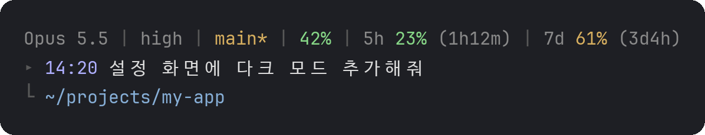

# claude-statusline

[English](README.md) | **한국어**

[Claude Code](https://code.claude.com)용으로 C로 만든 빠르고 가벼운 statusline입니다. 사용량, git 브랜치, 마지막 질문, 현재 폴더를 차분한 세 줄로 보여줍니다.



> **게이지 버전에서 업데이트하나요?** 화면 구성이 바뀌었고, 이제 2번째 줄에 **마지막으로 입력한 질문**이 나옵니다. 질문에 붙여넣은 비밀 정보도 그대로 보입니다.

## 설치

macOS(Apple 실리콘)에서 테스트했고 Linux는 테스트하지 않았습니다. 브랜치 표시에는 git 2.17 이상(보안상 2.38 이상 권장)이 필요하고, 빌드에는 C 컴파일러와 `make`가 필요합니다(macOS: `xcode-select --install`). `python3`는 `settings.json`을 수정할 때만 쓰며, 없으면 직접 추가할 내용을 출력합니다.

```sh
git clone https://github.com/sjlee42/claude-statusline.git
cd claude-statusline
make install
```

| 명령 | 하는 일 |
|---|---|
| `make install` | `~/.claude/statusline`으로 빌드하고 `settings.json`에 등록합니다(`.bak` 백업). 다른 statusline이 있으면 바꾸기 전에 묻습니다. |
| `git pull && make install` | 바이너리를 업데이트합니다. 기존 `statusLine` 설정은 그대로 두므로 `refreshInterval`이 없으면 직접 추가하세요. |
| `make uninstall` | 바이너리를 지우고, `statusLine` 항목이 이 바이너리를 실행하면 그 항목도 지웁니다. |

`sudo` 없이 실행하세요. `settings.json.bak`에는 API 키가 들어 있을 수 있으니 dotfile 저장소에 올리지 마세요.

`CLAUDE_CONFIG_DIR`도 지원하며 절대 경로여야 합니다. 직접 설정하려면 `~/.claude/settings.json`에 추가하세요(`CLAUDE_CONFIG_DIR`를 쓰면 두 경로 모두 그 폴더로).

```json
{
  "statusLine": {
    "type": "command",
    "command": "~/.claude/statusline",
    "refreshInterval": 60
  }
}
```

`refreshInterval`이 있어야 가만히 있을 때도 리셋까지 남은 시간이 갱신됩니다.

## 표시 내용

| 줄 | 내용 |
|---|---|
| 1 | 모델, effort, git 브랜치(변경이 있으면 `*`), 컨텍스트 사용률, 5시간·7일 사용량과 리셋까지 남은 시간 |
| 2 | 마지막으로 입력한 질문의 시각과 앞 60자 |
| 3 | 현재 폴더 |

2번째 줄은 `<`로 시작하는 메시지(Claude Code가 명령 출력을 표시하는 방식)와 8MB가 넘는 기록(아주 큰 이미지 첨부 등)을 건너뛰고 그 앞의 질문을 보여줍니다.

퍼센트는 50% 미만이면 초록, 50%부터 노랑, 80%부터 빨강입니다. 컨텍스트는 값이 오기 전까지 0%로 표시합니다. 그 밖에 정보가 없는 부분은 생략합니다(git 밖에서는 브랜치, Pro/Max 요금제가 아니면 사용량, 첫 질문 전이거나 질문이 64MB보다 뒤에 있으면 2번째 줄).

## 속도

Apple M2에서 합성 세션 기록으로 반복 실행한 중앙값이며, 프로세스 시작 시간을 포함합니다.

| 상황 | 기존 bash + `jq` | 이 버전 (C) |
|---|---|---|
| 짧은 세션 | 31.4 ms | **2.6 ms** |
| 32MB 세션 | 459.3 ms | **2.5 ms** |
| 마지막 질문이 17MB 뒤 (기존은 못 찾음) | 455.3 ms | **4.5 ms** |
| git 저장소 안 | 32.6 ms | **6.7 ms** |

git 밖에서 최대 메모리는 1.6MB입니다(기존 7.0MB).

대화 기록을 끝에서부터 거꾸로 읽다가 마지막 질문을 찾으면 멈춥니다. 그래서 세션 길이가 아니라 마지막 질문이 얼마나 뒤에 있는지에 따라 시간이 정해집니다.

## 자주 묻는 질문

**토큰이나 컨텍스트를 쓰나요?** 아니요. 로컬에서 실행되고 출력은 화면에만 그려집니다. [공식 문서](https://code.claude.com/docs/en/statusline)를 참고하세요.

**무엇을 읽나요?** Claude Code가 넘겨주는 statusline 데이터, 현재 세션 기록의 끝부분, `git status`입니다. 프로그램 자체에는 네트워크 코드가 없고 파일도 쓰지 않습니다. 다만 `git status`는 그 저장소의 git 설정을 따르고 설정에는 실행할 프로그램(clean filter 등)이 들어갈 수 있으니, 직접 `git status`를 실행할 때처럼 믿을 수 있는 저장소에서만 쓰세요.

**스크린샷에 질문이 보여도 되나요?** 주의하세요. 2번째 줄에는 질문(붙여넣은 키 포함)이, 3번째 줄에는 폴더가 나오니 화면을 공유하기 전에 확인하세요.

**팔레트와 바는 어디 갔나요?** 이 버전은 스타일이 하나입니다. 이전 버전은 [`96bad0c`](https://github.com/sjlee42/claude-statusline/tree/96bad0c)에 있습니다. `settings.json`에 남은 예전 옵션은 무시됩니다.

## 함께 볼 만한 Claude Code statusline

더 많은 기능이나 테마, 시각적 편집기가 필요하다면 아래 프로젝트들도 좋은 선택입니다. 별 수는 2026-11-09 기준입니다.

| 프로젝트 | ★ | 언어 | 특징 |
|---|---|---|---|
| [jarrodwatts/claude-hud](https://github.com/jarrodwatts/claude-hud) | 29.1k | JavaScript (플러그인) | 여러 줄 HUD: 컨텍스트, 실행 중인 도구와 에이전트, todo 진행률 |
| [sirmalloc/ccstatusline](https://github.com/sirmalloc/ccstatusline) | 13.6k | TypeScript | 꾸미기 자유도 최고, powerline 스타일, 테마, TUI 편집기 |
| [Haleclipse/CCometixLine](https://github.com/Haleclipse/CCometixLine) | 3.5k | Rust | 빠른 네이티브 바이너리, 사용량 바가 있는 2줄 구성, 테마 |
| [kamranahmedse/claude-statusline](https://github.com/kamranahmedse/claude-statusline) | 1.4k | Shell | 큼직한 점 게이지로 current/weekly 표시 (이 프로젝트에 영감을 줌) |
| [Owloops/claude-powerline](https://github.com/Owloops/claude-powerline) | 1.2k | TypeScript | vim 스타일 powerline, minimal/powerline/capsule/tui 스타일 |
| [leeguooooo/claude-code-usage-bar](https://github.com/leeguooooo/claude-code-usage-bar) | 389 | Python | 5h/7d 사용량 바, 리셋 카운트다운, 스타일 3개 × 테마 9개 |
| [Astro-Han/claude-pace](https://github.com/Astro-Han/claude-pace) | 245 | Bash + jq | 사용 속도(pace)를 고려한 한도 추적, 단일 파일 |
| [Wangnov/claude-code-statusline-pro](https://github.com/Wangnov/claude-code-statusline-pro) | 239 | Rust | 그라데이션 컨텍스트 바, Nerd Font·이모지·텍스트 모드 |
| [alp82/claude-statusline](https://github.com/alp82/claude-statusline) | 26 | Bash | 컨텍스트·5h·7d 바, 에이전트별 줄 표시 |
| [Dworf/statusline-bar](https://github.com/Dworf/statusline-bar) | 24 | Bash + jq | 프리셋과 테마, 표시 항목 49개 중에서 선택 |

[ccusage](https://github.com/ccusage/ccusage)(★19.4k)도 참고할 만합니다. 사용량·비용 분석 도구인데 statusline 모드도 제공합니다.

**왜 또 하나를 만들었나요?** 사용량, 브랜치, 마지막에 한 질문을 한눈에 보고 싶었습니다. 네이티브 속도로, 한 번에 다 읽을 수 있을 만큼 작은 파일 하나로요.

## 라이선스

[MIT](LICENSE)
