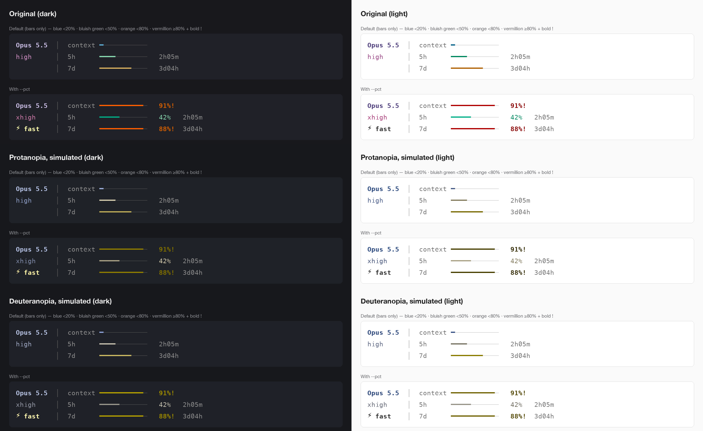

# claude-statusline

[English](README.md) | **한국어**

[Claude Code](https://code.claude.com)용으로 C로 만든 빠르고 가벼운 statusline 테마입니다. 컨텍스트와 5시간·주간 사용량을 바로 보여주고, 어두운·밝은·색맹 친화 팔레트를 제공합니다.
약 50KB짜리 바이너리 하나이고, 실행할 때 jq·Node·Python 같은 의존성이 없습니다. 한 번 실행에 약 3ms가 걸리며, 대부분은 프로세스 시작 시간입니다.
팔레트는 설치할 때 한 번 고르며, 상태를 색만으로 표시하지 않습니다.

```
Opus 5.5  │  context ━━━━━───────
high      │  5h      ━━━━━━━━────   2h05m
⚡fast    │  7d      ━━━━━━━━━━━─!  3d04h
```

`--pct`를 붙이면 퍼센트 숫자도 함께 표시합니다.

```
Opus 5.5  │  context ━━━━━───────   42%
high      │  5h      ━━━━━━━━────   65%   2h05m
⚡fast    │  7d      ━━━━━━━━━━━─   88%!  3d04h
```

| 어두운 터미널 | 밝은 터미널 (`--light`) |
|---|---|
|  |  |

## 설치

C 컴파일러와 `make`가 필요합니다(macOS: `xcode-select --install`). `python3`는 `settings.json`을 수정할 때만 쓰며, 없으면 직접 추가할 줄을 출력합니다.

```sh
git clone https://github.com/sjlee42/claude-statusline.git
cd claude-statusline
make install
```

`make install`은 바이너리를 빌드해 `~/.claude/statusline`으로 복사합니다. 처음 설치할 때는 세 가지를 묻고 미리보기를 보여준 뒤, `~/.claude/settings.json`에 `statusLine` 항목을 저장합니다(`.bak` 백업을 남깁니다).

1. 터미널 배경: 어두움 또는 밝음
2. 색맹 친화 팔레트: 사용 여부
3. 바 옆 퍼센트 숫자: 표시 여부

| 명령 | 하는 일 |
|---|---|
| `git pull && make install` | 업데이트. 바이너리만 교체하고 팔레트 설정은 유지합니다. |
| `make setup` | 팔레트를 다시 고릅니다. |
| `make uninstall` | 바이너리를 지우고, `statusLine` 항목이 이 바이너리를 실행하면 그 항목도 지웁니다. |

`CLAUDE_CONFIG_DIR`가 설정되어 있으면 `~/.claude` 대신 그 디렉터리를 씁니다.

### 직접 설정

`~/.claude/settings.json`에 원하는 옵션을 붙여 추가합니다.

```json
{
  "statusLine": {
    "type": "command",
    "command": "~/.claude/statusline --dark"
  }
}
```

| 옵션 | 효과 |
|---|---|
| `--dark` (기본) / `--light` | 어두운·밝은 터미널 배경용 팔레트 |
| `--cb` | 색맹 친화 팔레트 (적록색맹 대응) |
| `--pct` | 바 옆에 퍼센트 숫자도 표시 |

## 표시 내용

| 열 | 내용 |
|---|---|
| 왼쪽 | 위에서부터 모델 이름, effort(`low` … `max`), fast 모드일 때 `⚡fast` |
| 오른쪽 | 정렬된 바 3개: **context**(컨텍스트 사용률), **5h**(5시간 사용량), **7d**(7일 사용량). 사용량 바 옆에는 리셋까지 남은 시간(회색) |

- 5h·7d 바는 Claude Code가 rate limit 정보를 넘겨줄 때만 표시됩니다(claude.ai Pro/Max 구독, 세션의 첫 응답 이후).
- 남은 시간은 1시간 미만이면 `42m`, 하루 미만이면 `2h05m`, 그 이상이면 `3d04h`로 표시합니다.
- 필드가 없어도 문제없이 표시합니다. 예를 들어 세션 초반에는 컨텍스트가 `--`(`--pct`면 `--%`)로 표시됩니다.

## 색

바 색은 사용률에 따라 바뀌고, 가장 높은 구간에는 색 없이도 알 수 있는 표시가 붙습니다.

| 사용률 | 기본 | 색맹 친화 (`--cb`) | 추가 단서 |
|---|---|---|---|
| 20% 미만 | 파랑 | 파랑 | — |
| 20~49% | 초록 | 청록 | — |
| 50~79% | 주황(앰버) | 주황 | — |
| 80% 이상 | 빨강 | 주홍 | 바 뒤에 **굵은** `!` (`--pct`면 굵은 숫자: `88%!`) |

- 바의 채운 부분은 굵은 선(`━`), 빈 부분은 얇은 선(`─`)이라 색 대비가 약해도 얼마나 찼는지 보입니다.
- 모델명은 계열(Fable, Opus, Sonnet, Haiku)마다 거의 무채색에 가까운 은은한 색을 쓰고, 이전 세대는 흐리고 굵지 않게 표시합니다. effort는 Claude Code의 `/effort` 선택 화면과 같은 색입니다(밝은 터미널에서는 더 진하게).

### 색맹 친화 모드 (`--cb`)

적록색맹(제1·제2색맹)을 위한 팔레트입니다. 기본 팔레트의 초록·주황·빨강은 적록색맹이면 구분하기 어렵기 때문입니다. 구간 색은 Okabe-Ito 팔레트를 따르고, 이웃한 구간은 밝기도 다릅니다. effort는 보라 계열로 바뀌어서 모델명과 effort 모두 게이지 상태로 오해되지 않습니다.

아래 이미지는 색맹 친화 팔레트의 출력(어두운·밝은 터미널, `--pct` 없이와 있이)을 제1색맹·제2색맹 시뮬레이션(Machado et al. 2009)과 나란히 보여줍니다. 80% 이상은 주황과 주홍이 비슷해 보이는 경우에도 굵은 `!` 표시로 알 수 있습니다.



## 속도

Mac에서 같은 예시 입력으로 200회씩 실행해 측정했습니다. 측정 도구가 프로세스를 띄우는 시간도 포함된 값입니다.

| 구현 | 중앙값 | p95 |
|---|---|---|
| **claude-statusline (C)** | **2.8 ms** | 3.4 ms |
| 같은 기능의 bash + `jq` 스크립트 | 27.7 ms | 33.2 ms |

Claude Code는 화면이 갱신될 때마다(300ms 디바운스) statusline 명령을 다시 실행하므로 시작 속도가 가장 중요합니다.

## 자주 묻는 질문

**토큰이나 컨텍스트를 쓰나요?** 아니요. statusline은 로컬에서 실행되고, 출력은 화면에만 그려질 뿐 모델에 전달되지 않습니다. [공식 문서](https://code.claude.com/docs/en/statusline)를 참고하세요.

**권한 모드(auto, plan 등)는 왜 표시하지 않나요?** statusline이 받는 데이터에 없고, Claude Code가 바로 아래 기본 표시줄에 이미 보여줍니다.

**어떤 필드를 읽나요?** `model.display_name`, `context_window.used_percentage`, `effort.level`, `fast_mode`, `rate_limits.{five_hour,seven_day}.{used_percentage,resets_at}`입니다. `statusline.c` 안의 작은 전용 JSON 조회 함수로 읽습니다.

## 함께 볼 만한 Claude Code statusline

더 많은 기능이나 테마, 시각적 편집기가 필요하다면 아래 프로젝트들도 좋은 선택입니다. 별 수는 2026-11-09 기준입니다.

| 프로젝트 | ★ | 언어 | 특징 |
|---|---|---|---|
| [jarrodwatts/claude-hud](https://github.com/jarrodwatts/claude-hud) | 29.1k | JavaScript (플러그인) | 여러 줄 HUD: 컨텍스트, 실행 중인 도구와 에이전트, todo 진행률 |
| [sirmalloc/ccstatusline](https://github.com/sirmalloc/ccstatusline) | 13.6k | TypeScript | 꾸미기 자유도 최고, powerline 스타일, 테마, TUI 편집기 |
| [Haleclipse/CCometixLine](https://github.com/Haleclipse/CCometixLine) | 3.5k | Rust | 빠른 네이티브 바이너리, 사용량 바가 있는 2줄 구성, 테마 |
| [kamranahmedse/claude-statusline](https://github.com/kamranahmedse/claude-statusline) | 1.4k | Shell | 큼직한 점 게이지로 current/weekly 표시 (이 프로젝트에 영감을 줌) |
| [Owloops/claude-powerline](https://github.com/Owloops/claude-powerline) | 1.2k | TypeScript | vim 스타일 powerline, minimal/powerline/capsule/tui 스타일 |
| [leeguooooo/claude-code-usage-bar](https://github.com/leeguooooo/claude-code-usage-bar) | 389 | Python | 5h/7d 사용량 바, 리셋 카운트다운, 스타일 3개 × 테마 9개 |
| [Astro-Han/claude-pace](https://github.com/Astro-Han/claude-pace) | 245 | Bash + jq | 사용 속도(pace)를 고려한 한도 추적, 단일 파일 |
| [Wangnov/claude-code-statusline-pro](https://github.com/Wangnov/claude-code-statusline-pro) | 239 | Rust | 그라데이션 컨텍스트 바, Nerd Font·이모지·텍스트 모드 |
| [alp82/claude-statusline](https://github.com/alp82/claude-statusline) | 26 | Bash | 컨텍스트·5h·7d 바, 에이전트별 줄 표시 |
| [Dworf/statusline-bar](https://github.com/Dworf/statusline-bar) | 24 | Bash + jq | 프리셋과 테마, 표시 항목 49개 중에서 선택 |

[ccusage](https://github.com/ccusage/ccusage)(★19.4k)도 참고할 만합니다. 사용량·비용 분석 도구인데 statusline 모드도 제공합니다.

**왜 또 하나를 만들었나요?** 점 게이지 디자인의 가독성은 살리면서 모든 바를 하나의 깔끔한 스타일로 통일하고, 네이티브 속도와 의존성 0을 원했습니다. 한 번에 다 읽을 수 있을 만큼 작은 파일 하나로요.

## 라이선스

[MIT](LICENSE)
