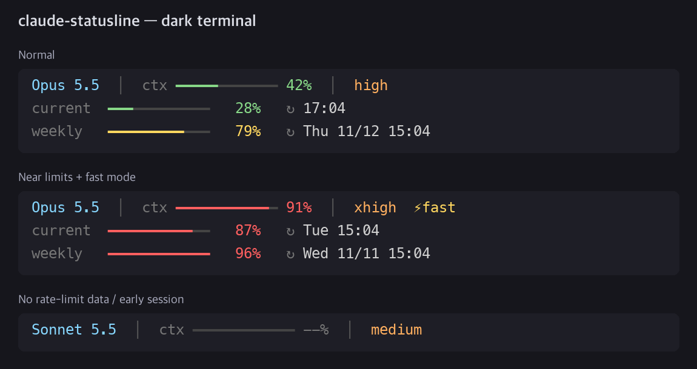
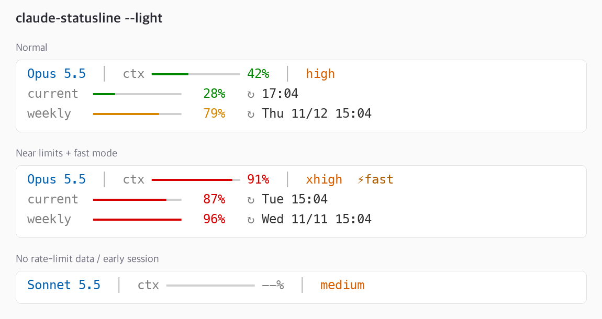

# claude-statusline

[English](README.md) | **한국어**

[Claude Code](https://code.claude.com)용으로 C로 만든 빠르고 가벼운 statusline입니다.
약 35KB짜리 바이너리 하나이고, jq·Node·Python 같은 의존성이 없습니다. 한 번 그리는 데 1~2ms 정도 걸립니다.

```
Opus 5.5  │  ctx ━━━━━━━━━━━━ 42%  │  high  ⚡fast
current  ━━━━━━━━━━━━   28%   ↻ 17:04
weekly   ━━━━━━━━━━━━   79%   ↻ Thu 11/12 15:04
```

| 어두운 터미널 | 밝은 터미널 (`--light`) |
|---|---|
|  |  |

## 표시 내용

| 줄 | 내용 |
|---|---|
| 1 | 모델 이름, 컨텍스트 사용률 바, effort(`low` … `max`), fast 모드일 때 `⚡fast` |
| 2 | **current**: 5시간 사용량과 리셋 시각 |
| 3 | **weekly**: 7일 사용량과 리셋 날짜·시각 |

- 바 색은 사용률 50% 미만이면 초록, 80% 미만이면 노랑, 그 이상이면 빨강입니다.
- current와 weekly는 같은 형식입니다. Claude Code가 rate limit 정보를 넘겨줄 때만 표시되고(claude.ai Pro/Max 구독, 세션의 첫 응답 이후), 정보가 없으면 첫 줄만 나옵니다.
- 리셋이 오늘이면 시각만, 다른 날이면 요일까지 표시합니다.
- 권한 모드(auto, plan 등)는 statusline이 받는 데이터에 없습니다. Claude Code가 바로 아래 기본 표시줄에 이미 보여줍니다.

## 설치

C 컴파일러(`cc`)가 필요합니다. macOS에서 컴파일러가 없다면 `xcode-select --install`을 실행하세요.

```sh
git clone https://github.com/sjlee42/claude-statusline.git
cd claude-statusline
make install          # 빌드한 뒤 ~/.claude/statusline 으로 복사
```

그다음 `~/.claude/settings.json`에 아래를 추가합니다.

```json
{
  "statusLine": {
    "type": "command",
    "command": "~/.claude/statusline"
  }
}
```

터미널 배경이 밝다면 `"~/.claude/statusline --light"`로 쓰세요.

## 속도

Mac에서 같은 예시 입력으로 200회씩 실행해 측정했습니다. 측정 도구가 프로세스를 띄우는 시간도 포함된 값입니다.

| 구현 | 중앙값 | p95 |
|---|---|---|
| **claude-statusline (C)** | **2.8 ms** | 3.4 ms |
| 같은 기능의 bash + `jq` 스크립트 | 27.7 ms | 33.2 ms |

Claude Code는 화면이 갱신될 때마다(300ms 디바운스) statusline 명령을 다시 실행하므로 시작 속도가 가장 중요합니다. `npx`로 실행하는 방식이 가장 느립니다. ccstatusline README에 따르면 `npx`로 실행하면 한 번 그리는 데 약 1.1초가 걸립니다.

## 토큰이나 컨텍스트를 쓰나요?

아니요. statusline은 로컬에서 실행되고, 출력은 화면에만 그려질 뿐 모델에 전달되지 않습니다. [공식 문서](https://code.claude.com/docs/en/statusline)를 참고하세요.

## 동작 방식

`statusline.c`는 Claude Code가 stdin으로 넘겨주는 JSON에서 작은 전용 파서로 다음 필드만 읽습니다.

`model.display_name`, `context_window.used_percentage`, `effort.level`, `fast_mode`,
`rate_limits.five_hour.{used_percentage,resets_at}`, `rate_limits.seven_day.{used_percentage,resets_at}`

필드가 없거나 `null`이어도 처리합니다. 예를 들어 세션 초반에는 컨텍스트가 `--%`로 표시됩니다.

## 함께 볼 만한 Claude Code statusline

이 프로젝트를 만들기 전에 GitHub에서 인기 있고 최근까지 업데이트된 statusline 프로젝트들을 조사했습니다. 더 많은 기능이나 테마, 시각적 편집기가 필요하다면 아래 프로젝트들도 좋은 선택입니다. 별 수는 2026-11-09 기준입니다.

| 프로젝트 | ★ | 언어 | 특징 |
|---|---|---|---|
| [jarrodwatts/claude-hud](https://github.com/jarrodwatts/claude-hud) | 29.1k | JavaScript (플러그인) | 여러 줄 HUD: 컨텍스트, 실행 중인 도구와 에이전트, todo 진행률 |
| [sirmalloc/ccstatusline](https://github.com/sirmalloc/ccstatusline) | 13.6k | TypeScript | 꾸미기 자유도 최고, powerline 스타일, 테마, TUI 편집기 |
| [Haleclipse/CCometixLine](https://github.com/Haleclipse/CCometixLine) | 3.5k | Rust | 빠른 네이티브 바이너리, 사용량 바가 있는 2줄 구성, 테마 |
| [kamranahmedse/claude-statusline](https://github.com/kamranahmedse/claude-statusline) | 1.4k | Shell | 큼직한 점 게이지로 current/weekly 표시 (이 프로젝트에 영감을 줌) |
| [Owloops/claude-powerline](https://github.com/Owloops/claude-powerline) | 1.2k | TypeScript | vim 스타일 powerline, minimal/powerline/capsule/tui 스타일 |
| [leeguooooo/claude-code-usage-bar](https://github.com/leeguooooo/claude-code-usage-bar) | 389 | Python | 5h/7d 사용량 바, 리셋 카운트다운, 스타일 3개 × 테마 9개 |
| [Astro-Han/claude-pace](https://github.com/Astro-Han/claude-pace) | 245 | Bash + jq | 사용 속도(pace)를 고려한 한도 추적, 단일 파일 |
| [Wangnov/claude-code-statusline-pro](https://github.com/Wangnov/claude-code-statusline-pro) | 239 | Rust | 그라데이션 컨텍스트 바, Nerd Font·이모지·텍스트 모드 |
| [alp82/claude-statusline](https://github.com/alp82/claude-statusline) | 26 | Bash | 컨텍스트·5h·7d 바, 에이전트별 줄 표시 |
| [Dworf/statusline-bar](https://github.com/Dworf/statusline-bar) | 24 | Bash + jq | 프리셋과 테마, 표시 항목 49개 중에서 선택 |

[ccusage](https://github.com/ccusage/ccusage)(★19.4k)도 참고할 만합니다. 사용량·비용 분석 도구인데 statusline 모드도 제공합니다.

**왜 또 하나를 만들었나요?** 점 게이지 디자인의 가독성은 살리면서 모든 바를 하나의 깔끔한 스타일로 통일하고, 네이티브 속도와 의존성 0을 원했습니다. 한 번에 다 읽을 수 있을 만큼 작은 파일 하나로요.

## 라이선스

[MIT](LICENSE)
